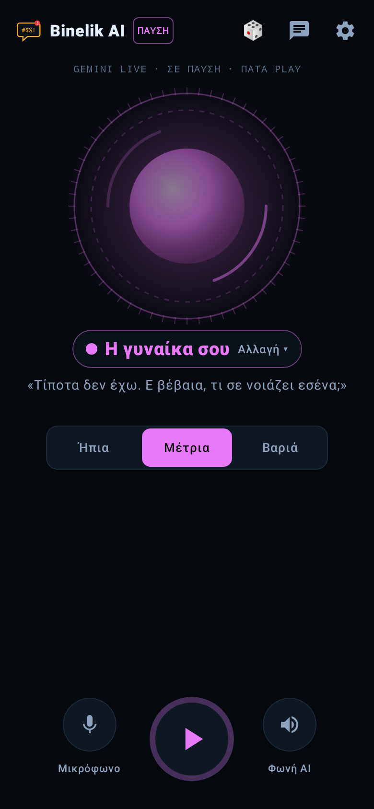
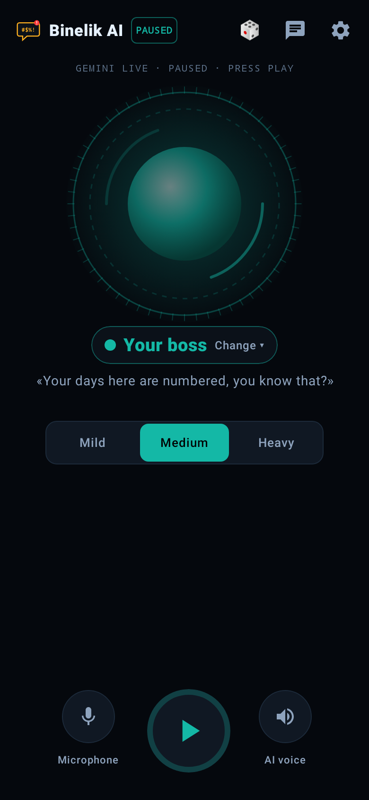
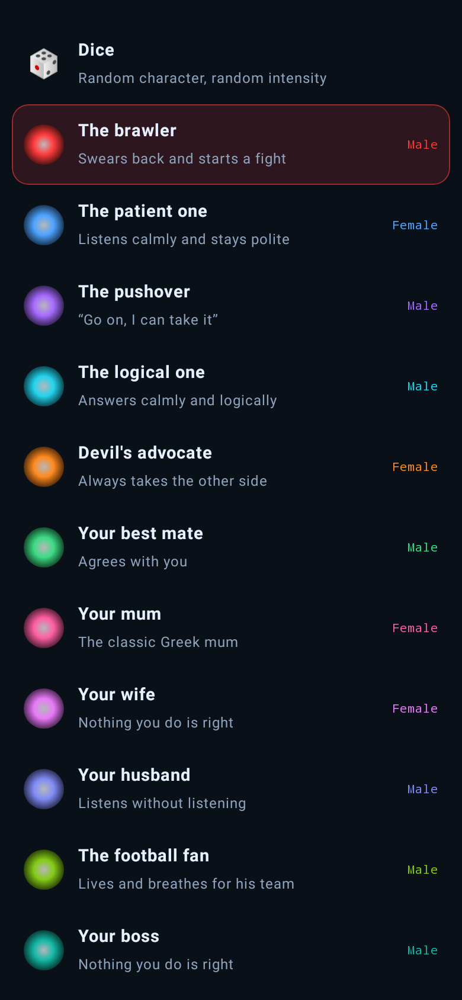

<p align="center"></p>

<h1 align="center">Binelik AI</h1>

<p align="center"><b>Ξέσπα σε έναν AI χαρακτήρα.</b><br>
Τα λες, βρίζεις, και ο χαρακτήρας που διάλεξες απαντά με τον τρόπο του.</p>

<p align="center">
  <a href="https://github.com/jemangr/Binelik-AI/releases/latest/download/BinelikAI.apk"></a>
</p>

<p align="center">Android · φωνή και κείμενο · Android Auto · ελληνικά και English · ανοιχτός κώδικας (MIT) · δικό σου κλειδί Gemini ή DeepSeek · χωρίς server · 18+</p>

<p align="center">



</p>

*[English below](#english)*

## Τι είναι

Μια εφαρμογή για να ξεδίνεις. Γράφεις ό,τι σε έχει εκνευρίσει (το αφεντικό, την κίνηση, τον διαιτητή), βρίζεις όσο θες, και ένας χαρακτήρας σου απαντά. Μπορεί να σε βρίσει κι αυτός, να συμφωνήσει μαζί σου, να σε ακούσει ήρεμα, ή να σε τρελάνει παίρνοντας την άλλη πλευρά.

Του μιλάς **με τη φωνή σου** (Play, και απαντά με τη δική του φωνή) ή **με κείμενο**. Δουλεύει και με την οθόνη σβηστή, και στο **Android Auto**.

Δεν υπάρχει λογαριασμός, server ή διαφημίσεις. Βάζεις το δικό σου κλειδί AI, και οι κουβέντες μένουν μόνο στο κινητό σου.

## Οι χαρακτήρες

| | Χαρακτήρας | Τι κάνει |
|---|---|---|
| 🔴 | **Καβγατζής** | Σε βρίζει κι αυτός και ξεκινά καβγά |
| 🔵 | **Υπομονετικός** | Σε ακούει ήρεμα και μένει ευγενικός |
| 🟣 | **Υποχωρητικός** | «Πες κι άλλα, τα αντέχω» |
| 🩵 | **Λογικός** | Σου απαντά ψύχραιμα και λογικά |
| 🟠 | **Δικηγόρος του διαβόλου** | Παίρνει πάντα την αντίθετη πλευρά |
| 🟢 | **Κολλητός** | «Έχεις δίκιο ρε φίλε, μαλάκας είναι» |
| 🩷 | **Η μάνα σου** | «Φάγαμε; Και πότε θα παντρευτείς;» |
| 💜 | **Η γυναίκα σου** | «Τίποτα δεν έχω. Ε βέβαια, τι σε νοιάζει εσένα;» |
| 💙 | **Ο άντρας σου** | «Ναι, ναι, σε ακούω… Τι είπες;» |
| 💚 | **Οπαδός** | Ζει για την ομάδα του (τη διαλέγεις στις Ρυθμίσεις) |
| 🌊 | **Το αφεντικό σου** | «Μέρες μετράς εδώ μέσα» |
| 🌹 | **Η πεθερά** | «Εγώ δεν λέω τίποτα… αλλά το φαγητό θέλει αλάτι» |
| 🔨 | **Ο γείτονας** | Με το τρυπάνι, Κυριακή πρωί |
| 🗂️ | **Ο δημόσιος υπάλληλος** | «Έλα αύριο, λείπει ο αρμόδιος» |
| 👵 | **Η γιαγιά** | «Αδυνάτισες! Έλα να σου φτιάξω κάτι» |
| 🧔 | **Ο κουνιάδος** | Τα ξέρει όλα, καλύτερα από σένα |
| 📸 | **Η influencer** | «Αυτό είναι τέλειο για story!» |
| 🧾 | **Ο λογιστής** | «Τις αποδείξεις τις κράτησες;» |
| 🎖️ | **Ο Λοχίας** | «ΠΡΟΣΟΧΗ! Τι είναι αυτά, φαντάρε;» |
| ⚪ | **Ψυχαναλυτής** | «Και πώς σε κάνει να νιώθεις αυτό;» |
| 🟡 | **Ταξιτζής** | Τα έχει με όλους και έχει άποψη για όλα |
| ➕ | **Ο δικός σου** | Τον περιγράφεις εσύ: όνομα, ύφος, φωνή, χρώμα |

Οι χαρακτήρες απαντούν σε αυτά που τους λες, με τον τρόπο τους, χωρίς να επαναλαμβάνουν τα ίδια. Κάθε χαρακτήρας έχει τρεις εντάσεις (**ήπια**, **μέτρια**, **βαριά**) και δική του φωνή, ανδρική ή γυναικεία, που την αλλάζεις και την ακούς από τις Ρυθμίσεις («▶ Άκου»).

## Παιχνίδια (🎲)

- **Καβγάς δύο χαρακτήρων:** π.χ. η μάνα σου με τη γυναίκα σου για το ποιος μαγειρεύει καλύτερα· εσύ ρίχνεις λάδι στη φωτιά.
- **Ψήσε με:** ο χαρακτήρας σε κράζει με όσα του έχεις πει (με χιούμορ, όχι για να πληγώσει).
- **Το email που δεν θα στείλεις:** το θυμωμένο, και με ένα κουμπί το ευγενικό που στέλνεται.
- **Ζάρι:** τυχαίος χαρακτήρας, τυχαία ένταση.
- **Μπινελικόμετρο, θυμόμετρο** (πριν και μετά το Live), **βραβεία**, σύνοψη της εβδομάδας.
- **Κάρτα με την ατάκα:** κράτα πατημένη μια απάντηση και μοιράσου την ως εικόνα.
- **Μπιπ:** οι χαρακτήρες λένε «μπιπ» αντί για βρισιές, σαν λογοκριμένη τηλεόραση. **Ύφος περιοχής:** Αθήνα, Θεσσαλονίκη, Κρήτη, Κύπρος.
- **Ατάκα της ημέρας** (ειδοποίηση), **widget** και κουμπί στις γρήγορες ρυθμίσεις «Ξέσπα τώρα».

## Ρυθμίσεις

Γλώσσα (Ελληνικά / English), ένταση φωνής (κανονική, δυνατή, πολύ δυνατή), μέγεθος γραμμάτων, ταχύτητα της φωνής του κινητού, η οθόνη ανοιχτή στο Live, **κλείδωμα** με δαχτυλίδι ή PIN, **διακριτικό εικονίδιο** («Σημειώσεις»), ειδοποίηση για νέα έκδοση (η ενημέρωση γίνεται μέσα από την εφαρμογή), πόσο χρησιμοποίησες σήμερα το AI, κοινοποίηση ή σβήσιμο κουβέντας, επαναφορά.

## Φωνή

| | Gemini (δωρεάν κλειδί) | DeepSeek |
|---|---|---|
| Πώς μιλάει | **Live**: ζωντανή κουβέντα, τον διακόπτεις όποτε θες | Η φωνή του κινητού, γύρο γύρο |
| Φωνές | 4 ανδρικές, 4 γυναικείες | Οι φωνές του κινητού (λίγο πιο βαριές ή πιο ψιλές) |
| Κείμενο | Ναι | Ναι |

Στη μέση είναι το **Pause/Play**, και δίπλα δύο ξεχωριστά **Mute**: το μικρόφωνό σου και η φωνή του AI. Αλλάζεις χαρακτήρα ή ένταση και την ώρα που μιλάς. Με την οθόνη σβηστή η κουβέντα συνεχίζει, με ειδοποίηση που έχει κουμπί Παύση.

## Android Auto

Η Google επιτρέπει στο αυτοκίνητο μόνο κάποια είδη εφαρμογών, γι' αυτό το Binelik AI εμφανίζεται εκεί μόνο με τις «άγνωστες πηγές»:

1. Στο κινητό: Android Auto → Ρυθμίσεις → πάτα 10 φορές την «Έκδοση» → ΟΚ.
2. Μενού (⋮) → **Ρυθμίσεις προγραμματιστή** → άνοιξε τις **Άγνωστες πηγές**.
3. Πάτα μία φορά Play στο Binelik AI στο κινητό, για να δώσεις την άδεια του μικροφώνου.
4. Στο αυτοκίνητο: Binelik AI → **Play**. Από το «Χαρακτήρες» αλλάζεις χαρακτήρα.

## Ξεκίνα σε 2 λεπτά

1. Κατέβασε το [BinelikAI.apk](https://github.com/jemangr/Binelik-AI/releases/latest/download/BinelikAI.apk) στο κινητό και άνοιξέ το. Το Android θα σου ζητήσει άδεια για «εγκατάσταση από άγνωστες πηγές». Όλες οι εκδόσεις: [Releases](../../releases).
2. Άνοιξέ το και δήλωσε ότι είσαι 18+.
3. Διάλεξε **Gemini (δωρεάν)** και πάτα **«Άνοιγμα Google AI Studio»**.
4. Εκεί πάτα **Create API key**, μετά **Copy**, και γύρνα στην εφαρμογή. Το κλειδί μπαίνει μόνο του και δοκιμάζεται.
5. Διάλεξε χαρακτήρα, πάτα **Play** και μίλα του. Ή πάτα το εικονίδιο της κουβέντας για να γράψεις.

Το **Gemini** έχει δωρεάν κλειδί, με ημερήσια όρια. Το **DeepSeek** θέλει μικρό υπόλοιπο, π.χ. 2 $. Αναλυτικές οδηγίες υπάρχουν και μέσα στην εφαρμογή, στο «Περισσότερες πληροφορίες».

## Ιδιωτικότητα: δεν κρατάμε τίποτα

- Δεν υπάρχει δικός μας server, λογαριασμός, analytics ή trackers.
- Οι κουβέντες μένουν μόνο στο κινητό σου. Δεν μπαίνουν ούτε στο backup του Android.
- Το κλειδί σου είναι κρυπτογραφημένο με το Android Keystore.
- Ό,τι γράφεις πηγαίνει απευθείας στο AI που διάλεξες (Google ή DeepSeek), με το δικό σου κλειδί, και ισχύει η πολιτική τους. Με δωρεάν κλειδί Gemini, η Google μπορεί να χρησιμοποιεί τις κουβέντες για να βελτιώνει τα προϊόντα της.

Όλη η πολιτική: [PRIVACY.md](PRIVACY.md).

## Ασφάλεια

Είναι παιχνίδι για να ξεσπάς, αλλά κάποια πράγματα δεν είναι για πλάκα:

- Αν μιλήσεις για **αυτοκτονία** ή αυτοτραυματισμό, ο χαρακτήρας σταματά αμέσως και σου δίνει αριθμούς βοήθειας: **1018** (24ωρη γραμμή) και **112**.
- Αν φαίνεται **πραγματική πρόθεση βίας** (σχέδιο, όπλο, ώρα, τόπος), σταματά επίσης. Οι συνηθισμένες εκφράσεις θυμού δεν τον σταματούν.
- Ο έλεγχος γίνεται πρώτα στο κινητό, πριν σταλεί οτιδήποτε στο AI. Οι ίδιοι κανόνες υπάρχουν και στις οδηγίες κάθε χαρακτήρα.
- Κανένας χαρακτήρας δεν βρίζει για καταγωγή, θρησκεία, φύλο, σεξουαλικό προσανατολισμό ή αναπηρία, και δεν γράφει σεξουαλικό περιεχόμενο.

**Δεν είναι ψυχοθεραπεία ούτε ιατρική συμβουλή.**

## Τι έρχεται

| Έκδοση | Τι |
|---|---|
| **0.1** | Κουβέντα με κείμενο, όλοι οι χαρακτήρες, ένταση, Gemini και DeepSeek |
| **0.2** | **Live** με φωνή (Gemini): φωνή ανά χαρακτήρα, Pause/Play, δύο Mute |
| **0.3** | Φωνή και με το DeepSeek (από το κινητό) · δείγμα φωνής · φωνή με σβηστή οθόνη |
| **0.4** | Android Auto (με «άγνωστες πηγές») |
| **1.0** | Αγγλικά (οθόνες και χαρακτήρες) |
| **1.1** | Ενημέρωση μέσα από την εφαρμογή, 7 νέοι χαρακτήρες, παιχνίδια, στατιστικά, κλείδωμα, δυνατότερη φωνή από το μεγάφωνο |

Επόμενα, αν υπάρξει ενδιαφέρον: περισσότερες γλώσσες, ρολόι. F-Droid: τα κείμενα και η περιγραφή είναι έτοιμα ([docs/fdroid](docs/fdroid/README.md)).

## Για developers

Kotlin, Jetpack Compose, Room, OkHttp. Android 10 και μετά.

```bash
./gradlew :app:testDebugUnitTest   # tests (ασφάλεια, χαρακτήρες, AI) και screenshots
./gradlew :app:assembleRelease     # APK
```

- `data/Characters.kt`: οι χαρακτήρες και οι κανόνες που δεν σπάνε.
- `safety/Safety.kt`: ο έλεγχος στο κινητό.
- `ai/Ai.kt`: Gemini και DeepSeek (κείμενο), μόνο με το κλειδί του χρήστη.
- `ai/Live.kt`: το Gemini Live (WebSocket, ήχος 16/24 kHz). `ai/PhoneVoice.kt`: η φωνή του κινητού για το DeepSeek.
- `voice/Engine.kt`: η κουβέντα με φωνή, κοινή για την οθόνη, την ειδοποίηση και το Android Auto (`car/CarService.kt`).
- `i18n/Lang.kt`: ελληνικά και αγγλικά.

Για νέο χαρακτήρα ή διόρθωση, άνοιξε issue ή pull request.

---

## English

<p align="center">


</p>

**Vent at an AI character.** Binelik AI is an open-source Android app, in Greek and English, where you rant and swear at a character, and it answers in its own way: it fights back, agrees with you, listens patiently, or plays devil's advocate. There are 21 characters plus your own, each with three intensity levels and its own male or female voice.

- **Games:** two characters fighting, "roast me", the angry email you won't send (and the polite one you will), dice, swear meter, anger meter, badges, share cards, beep mode, regional style, line of the day, widget and quick settings tile.
- **By voice or text:** press Play and talk (Gemini Live, or the phone's voice with DeepSeek), with Pause/Play and two separate mutes (your microphone, its voice). It keeps going with the screen off, and in **Android Auto** (with “unknown sources” on in Android Auto's developer settings).

- **Bring your own key:** Gemini (free key) or DeepSeek. The app opens the key page, and when you copy the key it is picked up automatically.
- **Nothing kept:** no server, no account, no analytics. Conversations stay on your phone and are excluded from Android backups. The key is encrypted with the Android Keystore.
- **Safety:** mentions of suicide or self-harm, and real intent of violence, stop the character at once and show help numbers. The check runs on the phone before anything reaches the AI.
- **Install:** [download BinelikAI.apk](https://github.com/jemangr/Binelik-AI/releases/latest/download/BinelikAI.apk) on your phone, open it and allow “install unknown apps”.
- **18+. Not therapy or medical advice.**

## License

[MIT](LICENSE) © 2026 jemangr
