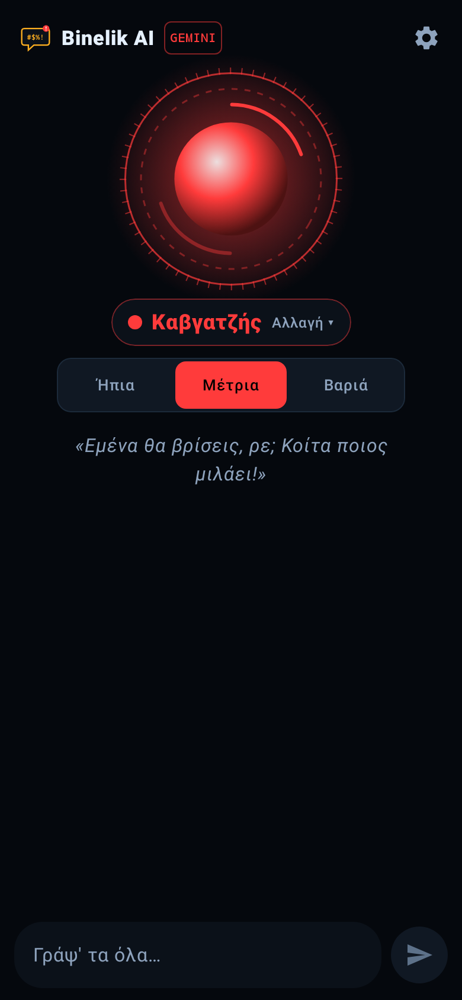
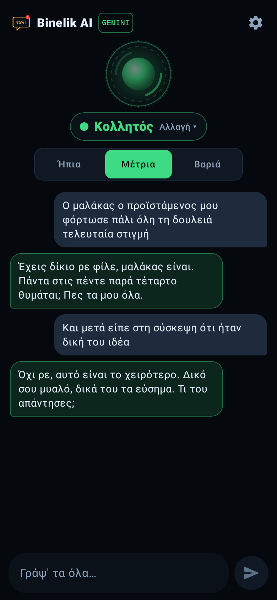
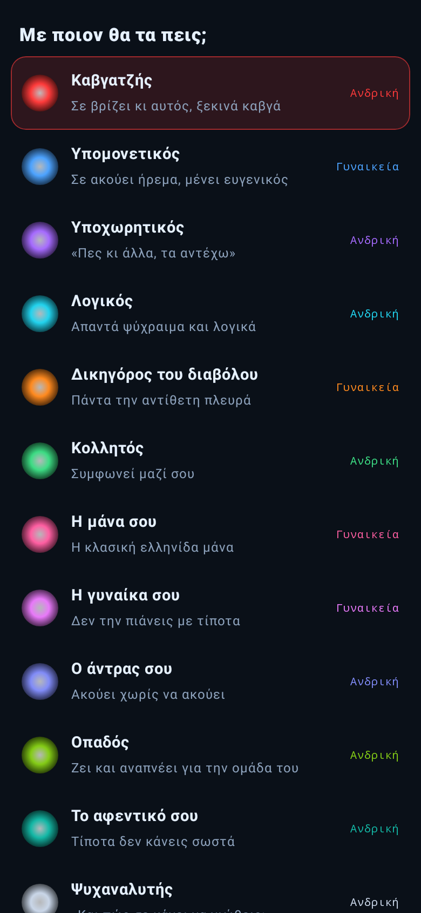
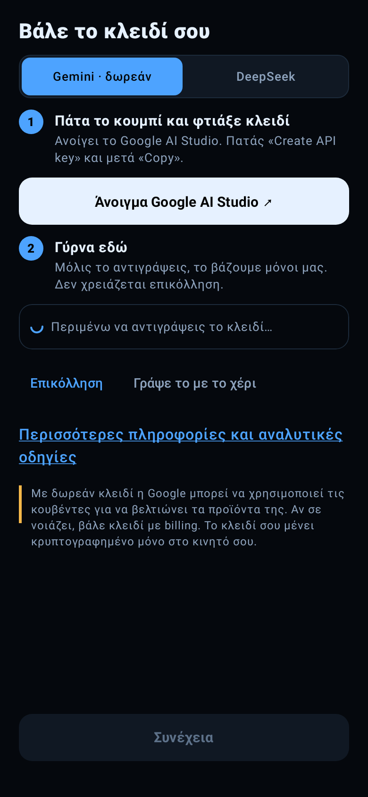

<p align="center"></p>

<h1 align="center">Binelik AI</h1>

<p align="center"><b>Ξέσπα σε έναν AI χαρακτήρα.</b><br>
Τα λες, βρίζεις, και ο χαρακτήρας που διάλεξες απαντά με τον τρόπο του.<br>
Android · ανοιχτός κώδικας (MIT) · δικό σου κλειδί Gemini ή DeepSeek · χωρίς server · 18+</p>

<p align="center">




</p>

*[English below](#english)*

## Τι είναι

Μια εφαρμογή για να ξεδίνεις. Γράφεις ό,τι σε έχει εκνευρίσει (το αφεντικό, την κίνηση, τον διαιτητή), βρίζεις όσο θες, και ένας χαρακτήρας σου απαντά. Μπορεί να σε βρίσει κι αυτός, να συμφωνήσει μαζί σου, να σε ακούσει ήρεμα, ή να σε τρελάνει παίρνοντας την άλλη πλευρά.

Δεν υπάρχει λογαριασμός, server ή διαφημίσεις. Βάζεις το δικό σου κλειδί AI, και οι κουβέντες μένουν μόνο στο κινητό σου.

## Οι χαρακτήρες

| | Χαρακτήρας | Τι κάνει |
|---|---|---|
| 🔴 | **Καβγατζής** | Σε βρίζει κι αυτός και ξεκινά καβγά |
| 🔵 | **Υπομονετικός** | Σε ακούει ήρεμα και μένει ευγενικός |
| 🟣 | **Υποχωρητικός** | «Πες κι άλλα, τα αντέχω» |
| 🩵 | **Λογικός** | Σου απαντά ψύχραιμα και λογικά |
| 🟠 | **Δικηγόρος του διαβόλου** | Παίρνει πάντα την αντίθετη πλευρά |
| 🟢 | **Κολλητός** | «Έχεις δίκιο ρε φίλε, μαλάκας είναι» |
| 🩷 | **Η μάνα σου** | «Φάγαμε; Και πότε θα παντρευτείς;» |
| 💜 | **Η γυναίκα σου** | «Τίποτα δεν έχω. Ε βέβαια, τι σε νοιάζει εσένα;» |
| 💙 | **Ο άντρας σου** | «Ναι, ναι, σε ακούω… Τι είπες;» |
| 💚 | **Οπαδός** | Ζει για την ομάδα του (τη διαλέγεις στις Ρυθμίσεις) |
| 🌊 | **Το αφεντικό σου** | «Μέρες μετράς εδώ μέσα» |
| ⚪ | **Ψυχαναλυτής** | «Και πώς σε κάνει να νιώθεις αυτό;» |
| 🟡 | **Ταξιτζής** | Τα έχει με όλους και έχει άποψη για όλα |
| ➕ | **Ο δικός σου** | Τον περιγράφεις εσύ: όνομα, ύφος, φωνή, χρώμα |

Κάθε χαρακτήρας έχει τρεις εντάσεις: **ήπια**, **μέτρια**, **βαριά**.

## Ξεκίνα σε 2 λεπτά

1. Κατέβασε το APK από τα [Releases](../../releases) και εγκατέστησέ το. Το Android θα σου ζητήσει άδεια για «εγκατάσταση από άγνωστες πηγές».
2. Άνοιξέ το και δήλωσε ότι είσαι 18+.
3. Διάλεξε **Gemini (δωρεάν)** και πάτα **«Άνοιγμα Google AI Studio»**.
4. Εκεί πάτα **Create API key**, μετά **Copy**, και γύρνα στην εφαρμογή. Το κλειδί μπαίνει μόνο του και δοκιμάζεται.
5. Διάλεξε χαρακτήρα και ξέσπα.

Το **Gemini** έχει δωρεάν κλειδί, με ημερήσια όρια. Το **DeepSeek** θέλει μικρό υπόλοιπο, π.χ. 2 $. Αναλυτικές οδηγίες υπάρχουν και μέσα στην εφαρμογή, στο «Περισσότερες πληροφορίες».

## Ιδιωτικότητα: δεν κρατάμε τίποτα

- Δεν υπάρχει δικός μας server, λογαριασμός, analytics ή trackers.
- Οι κουβέντες μένουν μόνο στο κινητό σου. Δεν μπαίνουν ούτε στο backup του Android.
- Το κλειδί σου είναι κρυπτογραφημένο με το Android Keystore.
- Ό,τι γράφεις πηγαίνει απευθείας στο AI που διάλεξες (Google ή DeepSeek), με το δικό σου κλειδί, και ισχύει η πολιτική τους. Με δωρεάν κλειδί Gemini, η Google μπορεί να χρησιμοποιεί τις κουβέντες για να βελτιώνει τα προϊόντα της.

Όλη η πολιτική: [PRIVACY.md](PRIVACY.md).

## Ασφάλεια

Είναι παιχνίδι για να ξεσπάς, αλλά κάποια πράγματα δεν είναι για πλάκα:

- Αν μιλήσεις για **αυτοκτονία** ή αυτοτραυματισμό, ο χαρακτήρας σταματά αμέσως και σου δίνει αριθμούς βοήθειας: **1018** (24ωρη γραμμή) και **112**.
- Αν φαίνεται **πραγματική πρόθεση βίας** (σχέδιο, όπλο, ώρα, τόπος), σταματά επίσης. Οι συνηθισμένες εκφράσεις θυμού δεν τον σταματούν.
- Ο έλεγχος γίνεται πρώτα στο κινητό, πριν σταλεί οτιδήποτε στο AI. Οι ίδιοι κανόνες υπάρχουν και στις οδηγίες κάθε χαρακτήρα.
- Κανένας χαρακτήρας δεν βρίζει για καταγωγή, θρησκεία, φύλο, σεξουαλικό προσανατολισμό ή αναπηρία, και δεν γράφει σεξουαλικό περιεχόμενο.

**Δεν είναι ψυχοθεραπεία ούτε ιατρική συμβουλή.**

## Τι έρχεται

| Έκδοση | Τι |
|---|---|
| **0.1** (τώρα) | Κουβέντα με κείμενο, όλοι οι χαρακτήρες, ένταση, Gemini και DeepSeek |
| 0.2 | **Live** με φωνή (Gemini): φωνή ανά χαρακτήρα, ανδρική ή γυναικεία, Pause/Play, δύο Mute |
| 0.3 | Φωνή και με το DeepSeek (από το κινητό) |
| 0.4 | Android Auto (με «άγνωστες πηγές») |
| 1.0 | Αγγλικά |

## Για developers

Kotlin, Jetpack Compose, Room, OkHttp. Android 10 και μετά.

```bash
./gradlew :app:testDebugUnitTest   # tests (ασφάλεια, χαρακτήρες, AI) και screenshots
./gradlew :app:assembleRelease     # APK
```

- `data/Characters.kt`: οι χαρακτήρες και οι κανόνες που δεν σπάνε.
- `safety/Safety.kt`: ο έλεγχος στο κινητό.
- `ai/Ai.kt`: Gemini και DeepSeek, μόνο με το κλειδί του χρήστη.

Για νέο χαρακτήρα ή διόρθωση, άνοιξε issue ή pull request.

---

## English

**Vent at an AI character.** Binelik AI is an open-source Android app (in Greek for now) where you rant and swear at a character, and it answers in its own way: it fights back, agrees with you, listens patiently, or plays devil's advocate. There are 13 characters plus your own, each with three intensity levels.

- **Bring your own key:** Gemini (free key) or DeepSeek. The app opens the key page, and when you copy the key it is picked up automatically.
- **Nothing kept:** no server, no account, no analytics. Conversations stay on your phone and are excluded from Android backups. The key is encrypted with the Android Keystore.
- **Safety:** mentions of suicide or self-harm, and real intent of violence, stop the character at once and show help numbers. The check runs on the phone before anything reaches the AI.
- **18+. Not therapy or medical advice.**

## License

[MIT](LICENSE) © 2026 jemangr
